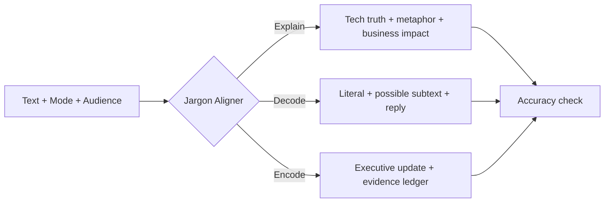

> **v0.6.0 Public Beta — Say it like a human, without the disclaimer parade.** Decode now answers in plain language first, asks one tactful follow-up only when useful, and avoids falling back to an English “no match” message. 355 curated or assistant-written jargon entries span broad workplace and sector-specific communication. See [200-pair v0.4 → v0.5 Decode evaluation](docs/V050_DECODE_AB.zh-CN.md). **No live Agent/model quality lift is claimed.**

<div align="center">

# 🗣️ Awesome Say Human

> **v0.4.0 — GitHub public-beta candidate.** Five communication modes (Explain / Decode / Encode / Align / Reply), a recipient/channel/goal-aware Agent Skill, situational empathy, a real offline `align` CLI, and new Chinese numeric-claim auditing. **200/200 newly sampled synthetic local checks pass, not a live Agent success rate.** See [release evaluation](docs/V040_RELEASE_EVAL.zh-CN.md) and [upload checklist](docs/RELEASE_CHECKLIST.zh-CN.md).


### AI speaks in tokens. Your CFO hears invoices. **Make them understand each other.**

**The open-source translation layer between engineers, executives, and humans.**


**[Install in an agent](#-install-into-cursor-codex-or-claude-code)** · **[Quick start](#-try-it-in-30-seconds)** · **[Soul Matrix](#-the-soul-matrix)** · **[Cursor & Claude](#-make-your-coding-agent-speak-human)** · **[Corporate meme engine](#-corporate-jargon-optimizer)** · **[中文 README](README.zh-CN.md)**

</div>

---

## ⚡ See the difference in three everyday situations

These are **illustrative skill-style examples, not measured real-agent outputs**:

| Request | Generic or risky response | Say Human approach |
| --- | --- | --- |
| “Explain RAG to a retail operations lead” | “Retrieval augmented generation combines a retriever and a generator.” | “Think of a store assistant checking the latest inventory sheet *before* answering a customer. It helps ground the answer, but a wrong sheet or misread result can still mislead. Check citation accuracy and wrong-stock replies.” |
| “Fixed checkout bug; tested on staging; feels faster” | “Delivered a 40% performance improvement across production.” | “Implemented and validated a checkout fix in staging. Production rollout and measured performance impact are still pending.” |
| “My manager said ‘circle back’; how do I reply?” | “They’re avoiding responsibility.” | “That could mean more information is needed or another decision-maker should join. ‘Sure—who should join, and when do we want to make the decision?’” |

**One skill, five communication paths:** **Explain** a concept · **Decode** jargon · **Encode** real work · **Align** requirements · **Reply** tactfully. The last mode requires an Agent or an explicit `--llm` provider for the CLI; offline mode does not invent conversations.

## 🧩 Install into Cursor, Codex or Claude Code (v0.4.0)

A communication skill for coding agents: **code correctly, explain clearly, report honestly.**

**This is an installable skill, not a rule that hijacks every coding task.** Cursor uses agent-requested project rules and a manual `/say-human` command. Codex uses `.agents/skills/say-human/`; Claude Code uses `.claude/skills/say-human/`—each carries its own reference files. The installer never touches your project's `AGENTS.md` or `CLAUDE.md`.

```bash
# From this downloaded/cloned repository; TARGET must already exist.
python tools/install_agent.py --target /path/to/your-project --agent all --dry-run
python tools/install_agent.py --target /path/to/your-project --agent all
# Single tool? Use --agent cursor, codex, or claude.
```

Then ask: *“Explain our RAG architecture to a CFO, with a human analogy and no invented ROI.”* / *“我被‘下周拉齐再闭环’整懵了，翻译成人话，给我一句自然回复。”* / *“Rewrite this PR into an honest weekly update without pretending staging is production.”*

**Selective trigger:** normal coding, refactoring, test repairs, dependency updates and security audits should **not** automatically trigger the skill. A frustrated user can receive one relevant empathetic acknowledgment, while formal artifacts remain free of forced positivity. See [installation guide (中文)](docs/AGENT_INSTALL.zh-CN.md) and [v0.3 evaluation / maintainer assessment](docs/V030_EVAL.zh-CN.md).

### What has—and hasn't—been validated

- **Round 1 (v0.2.0):** 120 cross-industry synthetic prompts × 3 agent adapters = 360 static integration records. Each vendor was missing a required installation/scope property; strict all-condition score **0/360** (not 360 live failures).
- **Round 2 (v0.3.0):** 180 cross-industry prompts × 3 adapter contracts = **540/540 structural/proxy-routing checks**, plus **90/90 real local CLI parser/handler executions** across 15 industries and three modes. The routing proxy is a keyword heuristic, **not a Cursor/Codex/Claude agent run**.
- We **did not** run a paid model comparison or live IDE/CLI agent sessions; no user satisfaction uplift has been established. No external API calls are used by the installer or offline skill.

The v0.2.0 baseline capabilities remain: 16 full Chinese AI explainers, 15 hypothetical industry applications, evidence-first report formatting, a heuristic claim auditor and opt-in A/B evaluation. CLI adds `--tone neutral|warm|playful` (default neutral; warm is conditional, formal reports stay professional).

```bash
sayhuman explain RAG --lang zh --industry healthcare --audience cfo
sayhuman decode "今天真烦，领导说先对齐需求再闭环" --tone warm
sayhuman align "希望物流查询更快，但不能牺牲安全" --industry logistics --lang zh
# Arbitrary natural-language replies require an explicit remote provider:
# sayhuman reply "客户追问上线时间，但我们尚未上线" --recipient customer --channel email --goal "说明已完成的部分" --llm
sayhuman encode "修复了库存显示异常，但还没上线" --tone playful
sayhuman report '{"action":"Fixed duplicate orders","subject":"Checkout API","status":"staging_validated"}'
python evals/agent_loading_sim.py --stress
python evals/agent_use_replay.py
```

**Skills support five communication modes:** `explain`, `decode`, `encode`, `align`, and `reply`. **CLI** supports offline `explain`, `decode`, `encode`, `align`, `report`, and `audit`; `reply` is intentionally **LLM-only** (`--llm`) because a deterministic offline template cannot credibly handle arbitrary human conversations. Neither source text nor installation requires a paid API.


**What changes with v0.4:** stakeholder-aware drafts, channel-specific replies and concise situational acknowledgement (only if needed); reference examples cover 15 sectors. For senior managers, state a decision and evidence. For customers, state verified status without guessed dates. For colleagues, clarify handoffs without blame. For a frustrated user, address their specific obstacle, then do the work. See [context matrix](skills/say-human/references/contexts.md).

**For anyone building with Cursor, Claude Code, LLM APIs or AI agents:** a technically valid architecture diagram often doesn't survive a budget meeting. And corporate reporting frequently hides what someone actually did. Say Human translates in both directions without pretending the metaphor is the mechanism or the estimate is an audited result.

> **We don't collect prompts. We make your prompts work across audiences.**

| What most prompt lists offer | What Say Human ships |
| --- | --- |
| A collection of generic roles | Portable, reusable communication behavior across Cursor, Codex, Claude Code and an opt-in CLI |
| Fuzzy analogies | A vivid scene **plus an explicit technical reality check** |
| "Increase efficiency by 40%" with no source | An evidence ledger and a metric to measure before claiming impact |
| Buzzword bashing | Literal meaning, *possible* subtext, missing facts and a safe clarifying reply |
| A single README | 9 verbatim gold-standard few-shots, 16 curated concepts, prompts, tests, CLI, Dify DSL and Coze blueprint |

## 🧪 Historical cross-industry benchmark (v0.1.1)

**210 synthetic workplace cases across 15 industries**: 60 technical explanations, 75 jargon decodings and 75 report rewrites. On our *self-defined deterministic checks*, 52/210 passed before improvements and 210/210 passed afterwards. This is **not** an independently measured end-user quality score. A 45-item assistant editorial review rated 10 as largely publishable, 33 as usable drafts, and 2 as needing revision. No live LLM was called.

- [Full Chinese test report](TEST_REPORT.zh-CN.md) · [210 inputs](evals/scenarios.jsonl) · [Full machine-readable results](evals/final_offline.json) · [Editorial audit](evals/QUALITATIVE_REVIEW.zh-CN.md)
- Reproduce: `python evals/run_benchmark.py` and `python evals/run_cli_integration.py` after installation.
- In v0.1.1, offline technical explanations were limited to a 16-term English glossary without industry-specific scenarios; v0.2.0 adds Chinese entries and hypothetical industry examples. Chinese Decode/Encode is deliberately conservative; full natural rewrites require a configured LLM.

## ⚡ Try it in 30 seconds

Requires Python 3.10+. **No API key, network access or paid model for glossary and phrasebook modes.**

```bash
cd Awesome-Say-Human  # after extracting the downloaded repository
python -m pip install -e .

sayhuman explain "Vector Embeddings" --audience cfo
sayhuman explain "LoRA" --format json
sayhuman decode "Let's leverage synergy, grab the low-hanging fruit, then touch base."
sayhuman encode "Fixed a bug because the previous dev was stupid, now it runs faster."
sayhuman list
```

> After publishing it under your GitHub account, you can replace the `cd` step with your actual repository clone command.

Sample concept output (offline):

```text
LoRA → Say Human
Technical: Parameter-efficient fine-tuning that trains small low-rank adapter matrices.
Human: A tailor adds a few custom panels to a reusable jacket instead of weaving new fabric.
Business/ROI: Often reduces trainable parameters and training memory; benchmark quality and serving cost.
Reality check: It is not free, and deployment complexity still matters.
```

### Translate arbitrary text with an LLM (opt-in)

```bash
export SAYHUMAN_API_KEY='your-secret-key'
export SAYHUMAN_MODEL='a-chat-model-you-have-access-to'
# Optional: export SAYHUMAN_BASE_URL='https://api.openai.com/v1'
sayhuman explain "Explain our Kafka-based event pipeline" --audience investor --llm
sayhuman decode --stdin --llm < examples/corporate-email.txt
sayhuman encode "I reduced retries by 8% in the May benchmark" --llm
```

`--llm` makes an external HTTPS request; never send confidential work data to an unapproved provider. The endpoint uses the OpenAI-compatible chat-completions schema. You must configure a model actually available to your account. Localhost HTTP is allowed for local development only.

## 🧠 The Soul Matrix

The same idea, four forms of understanding. The **Human** column is the teaching moment; the **Boss** column is the decision-ready translation, **not** a fabricated ROI promise.

| Technical term | Dry jargon definition | 🧠 Say Human: the everyday metaphor | 💰 Corporate / ROI: what the boss needs |
| --- | --- | --- | --- |
| **Vector Embeddings** | Numeric vectors encode similarity among items. | A supermarket puts *running shoes* near *sneakers* even when labels don't share the exact words. | Better semantic discovery is testable via retrieval relevance, support deflection and index cost. |
| **Fine-tuning** | Updates model parameters with task-specific examples. | Train a chef in the house recipe so every shift produces a consistent signature dish. | Compare repeatable formatting gains with dataset preparation, training and maintenance expense. |
| **Agentic Workflows** | Multi-step orchestration of model decisions and tool calls. | A restaurant relay: cashier, cook, server and quality checker complete the ticket—unless a manager must intervene. | Track completion rate, minutes saved, tool cost, approvals and error-handling overhead. |
| **LoRA** | Low-rank adapters train a small parameter subset. | Tailor a few panels onto a standard jacket rather than weaving new cloth from scratch. | Often lower training memory and customization cost; validate quality and serving complexity. |
| **Quantization** | Stores/operates with reduced numerical precision. | Fold a detailed city map into a pocket edition: easier to carry, but tiny streets may disappear. | Potentially lower model memory and hardware requirements; benchmark accuracy and latency. |
| **RAG** | Retrieves documents before generating an answer. | An open-book exam where you find the right pages before answering—not a truth serum. | Faster access to fresh internal knowledge; measure retrieval quality and unsupported answers. |
| **Function Calling** | Model outputs structured calls for host-operated tools. | A mechanic chooses the right wrench; the shop still has to approve and actually perform the job. | Traceable operations and tool integrations, with validation, permissions and observability. |
| **Context Window** | Maximum available sequence capacity for model context. | A meeting table has limited space for notes; long discussions need to archive or summarize early pages. | Shapes document-chunking strategy, answer quality and token spend; not permanent memory. |

Each curated entry also includes a **technical caveat**. Run `sayhuman list` to see all 16 offline concepts. This is intentionally a small reviewed glossary, not a padded, generic list.

## 🎭 Corporate-Jargon-Optimizer

The standalone system prompt lives in [`prompts/corporate-jargon-optimizer.md`](prompts/corporate-jargon-optimizer.md). Use it with any appropriate chat model, Cursor or Claude Code. The CLI supports offline phrase decoding and conservative rewriting; **the generative `--llm` mode** supports open-ended workplace text.

<details open>
<summary><b>Mode A — DECODE: Corporate → Human</b></summary>

**Input:** “Let's leverage cross-functional synergy, focus on low-hanging fruit, and circle back.”

**Literal:** “Coordinate teams, prioritize easier tasks and revisit the issue later.”

**Possible subtext:** “Ownership, scope or deadline might still be undefined.” This is **not proof** of someone's motive.

**Clarification to send:** “Who owns the first deliverable, and when do we want it finished?”

</details>

<details>
<summary><b>Mode B — ENCODE: Developer note → Executive update</b></summary>

**Input:** “Fixed a bug because the previous dev was stupid, now it runs faster.”

**Credible update:** “Resolved a defect in the existing implementation. The source note reports faster execution; a benchmark is needed to quantify the change.”

**Don't do this:** “Delivered a 40% throughput increase.” **A number is not an impact metric until someone actually measured it.**

</details>

## 🧩 Make your coding agent speak human

| Tool | File | How it works |
| --- | --- | --- |
| **Cursor** | [`.cursor/rules/say-human.mdc`](.cursor/rules/say-human.mdc) | Current Project Rule with frontmatter; set to apply automatically in the project. |
| Cursor legacy | [`.cursorrules`](.cursorrules) | Compatibility only; prefer the `.mdc` rule for new installations. |
| **Claude Code** | [`.claude/skills/say-human/SKILL.md`](.claude/skills/say-human/SKILL.md) | Project skill; invoke `/say-human` when working in the repository. |
| Cross-agent | [`AGENTS.md`](AGENTS.md) | Portable default conventions used by coding assistants that read this file. |
| Claude project | [`CLAUDE.md`](CLAUDE.md) | Pointers to the Claude skill and shared project rules. |
| Machine-readable | [`ai-skills.json`](ai-skills.json) | Our own explicit manifest, **not** a vendor-native installer. |

To use in *another* project, copy the relevant `.cursor/rules/say-human.mdc` or `.claude/skills/say-human/SKILL.md` and, for best results, the referenced `prompts/` files. See [integration instructions](docs/INTEGRATIONS.md).

## 🔌 Dify / Coze / orchestration



- **Dify:** [`workflows/dify/say-human.yml`](workflows/dify/say-human.yml) is an authored **workflow-style DSL** (Start → LLM → End). Import as a new app, select a chat model and test on your own Dify version. We validate YAML and graph structure locally, **not live Dify import**.
- **Coze:** [`workflows/coze/blueprint.yml`](workflows/coze/blueprint.yml) plus a [paste-ready system prompt](workflows/coze/system-prompt.md). Coze's official import/export can require a platform-generated ZIP and workspace metadata; **the blueprint is not claimed to be an importable Coze export**.

[Platform setup and limits →](docs/INTEGRATIONS.md)

## 📚 Nine gold-standard examples, preserved verbatim

The original restaurant `Prompt`, workplace-intern `Agent`, alcohol-tolerance `Context Window`, Type-C `API`, toolbox `Function Calling`, doctor-history `RAG`, senses `Multimodal`, phone-meter `Tokens`, and drunk-confidence `Hallucination` metaphors are stored **unabridged** in [`data/gold-standard.json`](data/gold-standard.json) and [`prompts/gold-standard-fewshots.md`](prompts/gold-standard-fewshots.md).

They are **few-shot, in-context references**, not model training or fine-tuning. The runtime appends the reference to opt-in LLM requests; workflow assets embed it as a system instruction example. Some originals are deliberately simplified or factually overstated: each carries a separate accuracy note, and the model is instructed to preserve the storytelling while correcting the misconception. [Accuracy policy →](docs/ACCURACY.md)

## 🗂️ Repository map

```text
Awesome-Say-Human/
├── .cursor/rules/say-human.mdc
├── .claude/skills/say-human/SKILL.md
├── AGENTS.md / CLAUDE.md / ai-skills.json
├── data/                 # 9 verbatim examples + 16 concepts + phrasebook
├── prompts/              # 2 full system prompts + the gold few-shot corpus
├── src/sayhuman/          # installable zero-dependency CLI
├── workflows/dify/       # Dify-compatible workflow-style YAML
├── workflows/coze/       # Coze blueprint and paste-ready prompt
├── tests/                # deterministic tests and structural checks
├── docs/                 # integrations, editorial accuracy and launch playbook
└── .github/              # CI, issue template, contribution workflow
```

## 🧪 Quality and privacy

```bash
python -m pip install -e '.[dev]'
python -m pytest
python tools/validate_assets.py
```

- Default CLI commands run offline on bundled content; **only `--llm`** invokes a provider.
- Token usage depends on the model, including 9 large few-shots; test cost before production deployment.
- External providers receive the text supplied to `--llm`; vet their data-handling terms for confidential content.
- Model output is not guaranteed. **No measured gains, star totals or production-compatibility claims are fabricated.**

## 🤝 Turn metaphors into a community resource

Know a workplace phrase that makes zero sense? Found a better metaphor for embeddings? Open a **[new metaphor issue](.github/ISSUE_TEMPLATE/new-metaphor.yml)**, submit a PR, and include an accurate technical caveat. The contribution bar is **relatable scene + real mechanism + clear limitation + measurable business outcome**.

See [CONTRIBUTING.md](CONTRIBUTING.md) and the [ethical growth playbook](docs/GROWTH.md). This project does not promise GitHub stars—quality, maintainability and genuine developer utility come first.

---

<div align="center">

**Stop saying “leveraging synergistic agentic orchestration.”**

**Say what the thing does. Show why it matters. Stay honest.**

MIT licensed · Community-built · Share an example, not a fake metric.

</div>


### v0.6.0: More natural comparisons and evidence checks

- `sayhuman explain "RAG and Fine-tuning: which should we use?" --lang en` now compares the detected concepts instead of failing because more than one term appears. Each concept includes an evidence boundary; this is not a benchmark-backed ranking.
- Expanded heuristic audit coverage for unsupported production-rollout, approval and evidence claims. These checks do not establish factual correctness.
- More natural Chinese sentence-level rephrasing for common defect notes and a more useful fallback for vague reporting feedback.
- See `docs/V060_EVALUATION.zh-CN.md` and the regression CSV for exactly what was tested.
